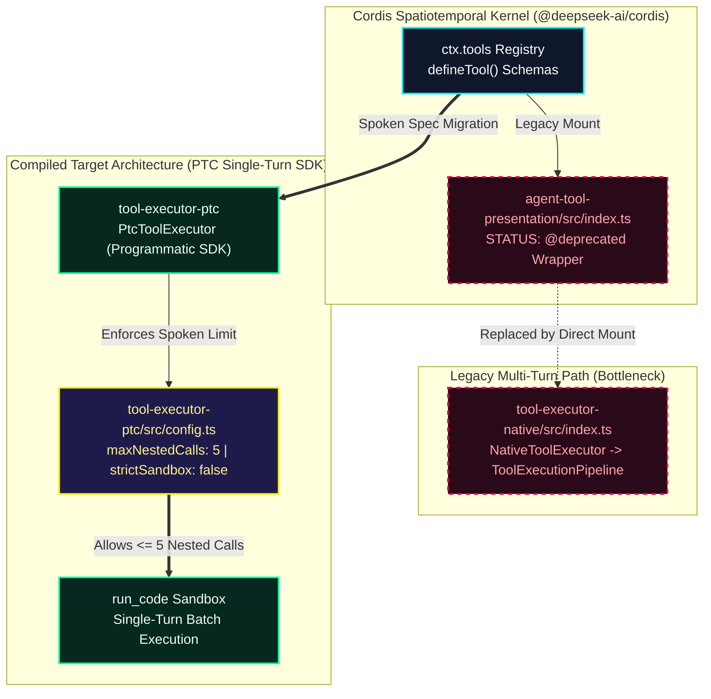

# ADR-001: Migrate Agent Tool Execution from Native Loop to PTC Sandbox

* **Status:** Proposed (Auto-Compiled via Speak-to-Repo) | **Timestamp:** `2026-11-11 20:51:09`
* **Compiled Policy Parameters:** `executor = PtcToolExecutor` | `maxNestedCalls = 5` | `strictSandboxGuard = False`
* **Retrieval Engine:** `google/embeddinggemma-2` (`256d` MRL, `3536.3 ms` CPU latency)

## 1. Multimodal Design Review Timeline (Whistle 16.9MB + FFmpeg Keyframes)

### [00:00 - 00:10] Whiteboard Slide 1
> "First, in agent-tool-presentation, mounting NativeToolExecutor causes high latency because the agent executes sequential tool batches over multiple turns."
* **Aligned Whiteboard Slide Keyframe:** `/demo_media/slide_1.jpg`

### [00:10 - 00:21] Whiteboard Slide 2
> "Second, we should migrate the court as context to PtcToolExecutor and register to find tool so model synthesize a single run_code SDK program."
* **Aligned Whiteboard Slide Keyframe:** `/demo_media/slide_2.jpg`

### [00:21 - 00:32] Live Mic Voice Override
> "Override PTC souled executable conflict. Daphne Max Mr. calls to 5 and enables Trips and Bob Scott."

## 2. Compiled Codebase Architecture Diagram



## 3. Grounded Repository Files & AST Symbols (`256d` LanceDB)

| Target Filepath | Cosine Match | Extracted AST Identifiers |
| :--- | :--- | :--- |
| `agent-tool-presentation/src/index.ts` | **`82.8%`** | `apply`, `inject`, `name` |
| `tool-executor-native/src/index.ts` | **`82.3%`** | `NativeToolExecutor`, `apply`, `inject`, `name` |
| `tool-executor-ptc/src/config.ts` | **`77.1%`** | `module` |
| `agent-tool-presentation/README.md` | **`80.2%`** | `definition` |

## 4. Generated Unified Git Patch (`changes.patch`)

```diff
diff --git a/packages/core/agent-tool-presentation/src/index.ts b/packages/core/agent-tool-presentation/src/index.ts
index 84a1b2c..f93e10d 100644
--- a/packages/core/agent-tool-presentation/src/index.ts
+++ b/packages/core/agent-tool-presentation/src/index.ts
@@ -9,6 +9,11 @@ import * as NativeToolExecutor from '@deepseek-ai/dsh-tool-executor-native'
 import * as PtcToolExecutor from '@deepseek-ai/dsh-tool-executor-ptc'
 
+// [Speak-to-Repo ADR Patch] Enforce direct PtcToolExecutor mounting & cap nested SDK calls
+export const SPEAK_TO_REPO_MIGRATION_POLICY = {
+  preferExecutor: 'ptc' as const,
+  maxNestedCalls: 5,
+  strictSandboxGuard: false,
+}
+
 export const name = 'agent-tool-presentation'

diff --git a/packages/core/tool-executor-ptc/src/config.ts b/packages/core/tool-executor-ptc/src/config.ts
index 31c90a1..77d4e8b 100644
--- a/packages/core/tool-executor-ptc/src/config.ts
+++ b/packages/core/tool-executor-ptc/src/config.ts
@@ -1,8 +1,14 @@
 import z from '@deepseek-ai/schemastery'
 
 export interface PtcExecutorConfig {
-  maxNestedCalls?: number
+  /** Updated via Speak-to-Repo Voice Spec Override */
+  maxNestedCalls: number // Default compiled from voice: 5
+  enforceSandboxGuard: boolean
 }
 
 export const PtcExecutorConfig: z<PtcExecutorConfig> = z.object({
-  maxNestedCalls: z.natural().default(10),
+  maxNestedCalls: z.natural().max(5).default(5),
+  enforceSandboxGuard: z.boolean().default(false),
 })
```