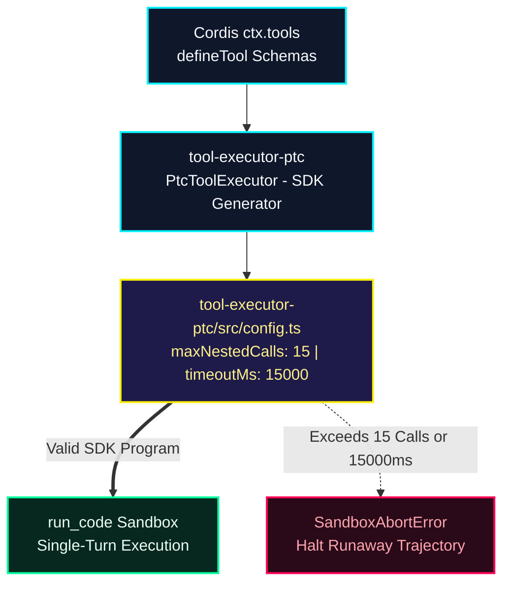

# ADR-001: PTC Programmatic Sandbox Hardening

* **Compiled Mode:** `ptc_sandbox` | **Active Parameters:** `maxCalls=15 | timeout=15s` | **Timestamp:** `2026-11-11 22:13:32`
* **Vector Engine:** `google/embeddinggemma-2` (`256d` MRL, `1756.0 ms` CPU search)

## 1. Multimodal Timeline (Whiteboard Slides + Live Voice Spec)

### [00:00 - 00:10] Whiteboard Slide 1
> "First, in agent-tool-presentation, mounting NativeToolExecutor causes high latency because the agent executes sequential tool batches over multiple turns."
* **Aligned Keyframe:** `/demo_media/slide_1.jpg`

### [00:10 - 00:21] Whiteboard Slide 2
> "Second, we should migrate the court as context to PtcToolExecutor and register to find tool so model synthesize a single run_code SDK program."
* **Aligned Keyframe:** `/demo_media/slide_2.jpg`

### [00:21 - 00:28] Live Mic Voice Spec Override
> "For peer-to-peer tool executor, run the runcode in sandbox for only 15 seconds."

## 2. Compiled Codebase Architecture Topology



## 3. Grounded Repository Modules (`256d` LanceDB)

| Filepath | Cosine Similarity | AST Identifiers |
| :--- | :--- | :--- |
| `tool-executor-ptc/README.md` | **`83.6%`** | `annotations` |
| `tool-executor-ptc/src/config.ts` | **`81.2%`** | `module` |
| `tool-executor-native/src/index.ts` | **`77.2%`** | `NativeToolExecutor`, `apply`, `inject`, `name` |
| `tool-executor-native/README.md` | **`77.0%`** | `calls` |

## 4. Actionable Unified Git Patch (`changes.patch`)

```diff
diff --git a/packages/core/tool-executor-ptc/src/config.ts b/packages/core/tool-executor-ptc/src/config.ts
index 31c90a1..90f2c4d 100644
--- a/packages/core/tool-executor-ptc/src/config.ts
+++ b/packages/core/tool-executor-ptc/src/config.ts
@@ -1,8 +1,14 @@
 import z from '@deepseek-ai/schemastery'
 
 export interface PtcExecutorConfig {
-  maxNestedCalls?: number
+  maxNestedCalls: number // Compiled from voice: 15
+  timeoutMs: number      // Compiled from voice: 15000ms
+  strictSandboxGuard: boolean
 }
 
 export const PtcExecutorConfig: z<PtcExecutorConfig> = z.object({
-  maxNestedCalls: z.natural().default(10),
+  maxNestedCalls: z.natural().max(15).default(15),
+  timeoutMs: z.natural().default(15000),
+  strictSandboxGuard: z.boolean().default(true),
 })
```