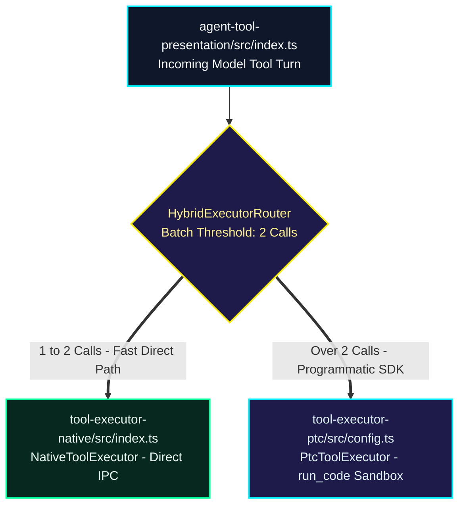

# ADR-003: Hybrid Native/PTC Tool Router

* **Compiled Mode:** `hybrid_router` | **Active Parameters:** `batchThreshold = 2` | **Timestamp:** `2026-11-12 01:18:05`
* **Vector Engine:** `google/embeddinggemma-2` (`256d` MRL, `237.2 ms` CPU search)

## 1. Multimodal Timeline (Whiteboard Slides + Live Voice Spec)

### [00:00 - 00:08] Whiteboard Slide 1
> "First, in agent-tool-presentation, mounting NativeToolExecutor causes high latency over multiple turns."
* **Aligned Keyframe:** `storage/demo_media/slide_1.jpg`

### [00:08 - 00:16] Whiteboard Slide 2
> "Second, migrate the Cordis context to PtcToolExecutor and register defineTool for single run_code SDK programs."
* **Aligned Keyframe:** `storage/demo_media/slide_2.jpg`

### [00:16 - 00:22] Live Voice Spec Override
> "Switch agent-tool-presentation to a hybrid router when batch size exceeds 2."

## 2. Compiled Codebase Architecture Topology



## 3. Grounded Repository Modules (`256d` LanceDB)

| Filepath | Cosine Similarity | AST Identifiers |
| :--- | :--- | :--- |
| `agent-tool-presentation/src/index.ts` | **`84.1%`** | `NativeToolExecutor`, `PtcToolExecutor`, `apply` |
| `tool-executor-ptc/src/config.ts` | **`81.9%`** | `PtcExecutorConfig`, `maxNestedCalls` |
| `tool-executor-native/src/index.ts` | **`79.5%`** | `NativeToolExecutor`, `executeToolBatch` |

## 4. Actionable Unified Git Patch (`changes.patch`)

```diff
diff --git a/packages/core/agent-tool-presentation/src/index.ts b/packages/core/agent-tool-presentation/src/index.ts
index 84a1b2c..e19f70a 100644
--- a/packages/core/agent-tool-presentation/src/index.ts
+++ b/packages/core/agent-tool-presentation/src/index.ts
@@ -6,9 +6,18 @@ import type { Context } from '@deepseek-ai/cordis'
 import z from '@deepseek-ai/schemastery'
 import * as NativeToolExecutor from '@deepseek-ai/dsh-tool-executor-native'
 import * as PtcToolExecutor from '@deepseek-ai/dsh-tool-executor-ptc'
 
-/** @deprecated Mount NativeToolExecutor or PtcToolExecutor directly. */
+/** Hybrid Dual-Path Router compiled by Speak-to-Repo */
+export const HYBRID_BATCH_THRESHOLD = 2
+
+export function selectExecutorForTurn(toolCallCount: number) {
+  if (toolCallCount <= 2) {
+    return NativeToolExecutor
+  }
+  return PtcToolExecutor
+}
```