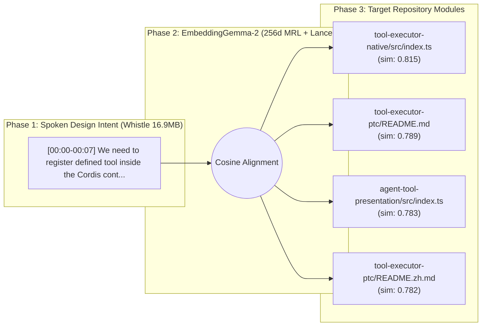

# Architecture Spec: Register defineTool inside Cordis context and run PTC tool executor

> **Auto-Compiled by Speak-to-Repo** on `2026-11-11 18:45:36` | **Vector Space:** `EmbeddingGemma-2 (256d MRL)` | **Query Latency:** `237.27 ms`

## 1. Acoustic Design Decisions (Cactus Whistle Aligned Segments)

* **[00:00 – 00:07]** *(Cosine Sim: `0.8725`)*
  > "We need to register defined tool inside the Cordis context and run tool executor PTC to patch the repository."

## 2. Cross-Modal Architecture Topology



## 3. Grounded Repository Modules & AST Signatures

| Filepath | Cosine Similarity (`256d`) | Extracted AST Symbols |
| :--- | :--- | :--- |
| `tool-executor-native/src/index.ts` | `0.8150` | `NativeToolExecutor`, `apply`, `inject`, `name` |
| `tool-executor-ptc/README.md` | `0.7894` | *(module entry)* |
| `agent-tool-presentation/src/index.ts` | `0.7834` | `apply`, `inject`, `name` |
| `tool-executor-ptc/README.zh.md` | `0.7822` | *(module entry)* |
| `tool-executor-ptc/src/config.ts` | `0.7517` | *(module entry)* |

## 4. Source Context Snippets

### `tool-executor-native/src/index.ts`
```ts
/** Native execution plugin for the mounting Agent, preset, or deployment scope. @module */
import type { Context } from '@deepseek-ai/cordis'
import { projectToolSchema } from '@deepseek-ai/dsh-tools'
import type { ToolDefinition, ToolExecutor, ToolModelInput, ToolBatchInput, ToolBatchResult } from '@deepseek-ai/dsh-tools'
import { ToolExecutionPipeline, executeToolBatch } from '@deepseek-ai/dsh-
```

### `tool-executor-ptc/README.md`
```md
---
description: "Program-based tool execution, generated SDKs, and nested-call limits."
kind: "package-reference"
---

# @deepseek-ai/dsh-tool-executor-ptc

English | [中文](README.zh.md)

## Summary

Use this executor when models should call tools through `run_code` programs. Mount a compatible PTC runtime and tool registry first. Scoped restrictions determine the generated SDK; only `run_code` is
```

### `agent-tool-presentation/src/index.ts`
```ts
/**
 * Select built-in tool execution for every Agent in the mounting scope.
 * @module
 * @deprecated Mount @deepseek-ai/dsh-tool-executor-native or @deepseek-ai/dsh-tool-executor-ptc directly.
 */

import type { Context } from '@deepseek-ai/cordis'
import z from '@deepseek-ai/schemastery'
import * as NativeToolExecutor from '@deepseek-ai/dsh-tool-executor-native'
import * as PtcToolExecutor from
```
