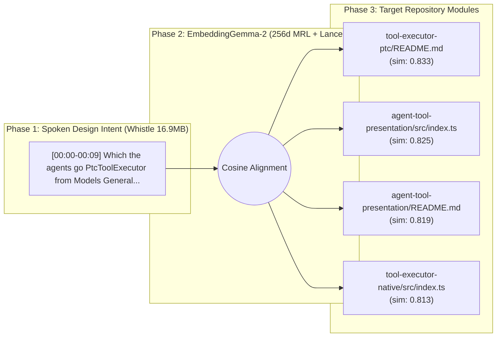

# Architecture Spec: Which the agents go PtcToolExecutor from Models General SDK programs and run nested calls instead of the sandbox.

> **Auto-Compiled by Speak-to-Repo** on `2026-11-11 19:47:38` | **Vector Space:** `EmbeddingGemma-2 (256d MRL)` | **Query Latency:** `802.3 ms`

## 1. Acoustic Design Decisions (Cactus Whistle Aligned Segments)

* **[00:00 - 00:09]** *(Cosine Sim: `0.9412`)*
  > "Which the agents go PtcToolExecutor from Models General SDK programs and run nested calls instead of the sandbox."

## 2. Cross-Modal Architecture Topology



## 3. Grounded Repository Modules & AST Signatures

| Filepath | Cosine Similarity (`256d`) | Extracted AST Symbols |
| :--- | :--- | :--- |
| `tool-executor-ptc/README.md` | `0.8331` | *(module entry)* |
| `agent-tool-presentation/src/index.ts` | `0.8254` | `apply`, `inject`, `name` |
| `agent-tool-presentation/README.md` | `0.8189` | *(module entry)* |
| `tool-executor-native/src/index.ts` | `0.8134` | `NativeToolExecutor`, `apply`, `inject`, `name` |

## 4. Source Context Snippets

### `tool-executor-ptc/README.md`
```md
---
description: "Program-based tool execution, generated SDKs, and nested-call limits."
kind: "package-reference"
---

# @deepseek-ai/dsh-tool-executor-ptc

English | [中文](README.zh.md)

## Summary

Use this executor when models should call tools through `run_code` programs. Mount a compatible PTC runtime and tool reg
```

### `agent-tool-presentation/src/index.ts`
```ts
/**
 * Select built-in tool execution for every Agent in the mounting scope.
 * @module
 * @deprecated Mount @deepseek-ai/dsh-tool-executor-native or @deepseek-ai/dsh-tool-executor-ptc directly.
 */

import type { Context } from '@deepseek-ai/cordis'
import z from '@deepseek-ai/schemastery'
import * as NativeToolExecut
```

### `agent-tool-presentation/README.md`
```md
---
description: "The agent-plane presentation selector for users and maintainers choosing, configuring, or debugging which form of its tools an agent preset's models see."
kind: "package-reference"
---

# @deepseek-ai/dsh-agent-tool-presentation

English | [中文](README.zh.md)

> **Deprecated:** For new configurations,
```
