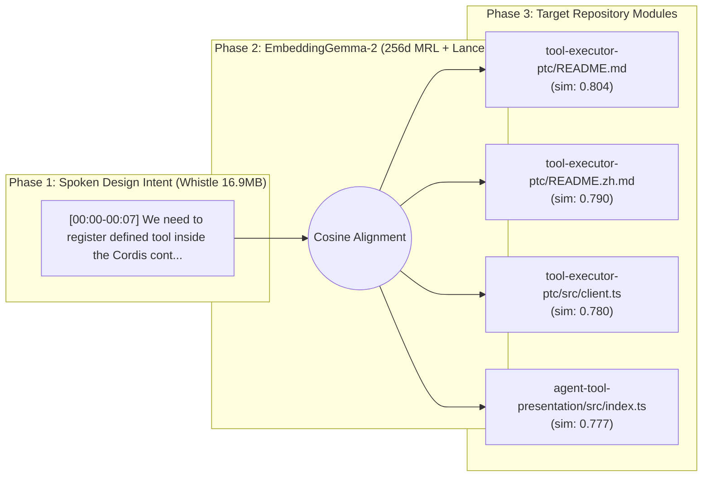

# Architecture Spec: Programmatic Tool Calling PTC run_code sandbox and SDK generation

> **Auto-Compiled by Speak-to-Repo** on `2026-11-11 19:03:58` | **Vector Space:** `EmbeddingGemma-2 (256d MRL)` | **Query Latency:** `242.08 ms`

## 1. Acoustic Design Decisions (Cactus Whistle Aligned Segments)

* **[00:00 - 00:07]** *(Cosine Sim: `0.8153`)*
  > "We need to register defined tool inside the Cordis context and run tool executor PTC to patch the repository."

## 2. Cross-Modal Architecture Topology



## 3. Grounded Repository Modules & AST Signatures

| Filepath | Cosine Similarity (`256d`) | Extracted AST Symbols |
| :--- | :--- | :--- |
| `tool-executor-ptc/README.md` | `0.8045` | *(module entry)* |
| `tool-executor-ptc/README.zh.md` | `0.7900` | *(module entry)* |
| `tool-executor-ptc/src/client.ts` | `0.7803` | *(module entry)* |
| `agent-tool-presentation/src/index.ts` | `0.7774` | `apply`, `inject`, `name` |
| `tool-executor-native/src/index.ts` | `0.7660` | `NativeToolExecutor`, `apply`, `inject`, `name` |

## 4. Source Context Snippets

### `tool-executor-ptc/README.md`
```md
---
description: "Program-based tool execution, generated SDKs, and nested-call limits."
kind: "package-reference"
---

# @deepseek-ai/dsh-tool-executor-ptc

English | [中文](README.zh.md)

## Summary

Use this executor when models should call tools through `run_code` programs. Mount a compatible PTC runtime and tool registry first. Scoped restrictions determine the generated SDK; only `run_code` is
```

### `tool-executor-ptc/README.zh.md`
```md
---
description: "基于程序的工具执行、生成 SDK 与嵌套调用限制。"
kind: "package-reference"
---

# @deepseek-ai/dsh-tool-executor-ptc

[English](README.md) | 中文

## 概述

当模型应通过 `run_code` 程序调用工具时，使用此执行器。先挂载兼容的 PTC 运行时和工具注册表。作用域限制决定生成的 SDK；只有 `run_code` 能被直接调用。可配置每个程序的工具调用总数上限，以及并行安全的子调用并发上限。

## 目录

- [使用本包](#use-this-package)
- [理解实现](#understand-the-implementation)
- [进一步探索](#further-exploration)
- [模型体验](#model-expe
```

### `tool-executor-ptc/src/client.ts`
```ts
/** Client entry for shared PTC event and message-source declarations. @module */
export type * from './types.ts'
```
